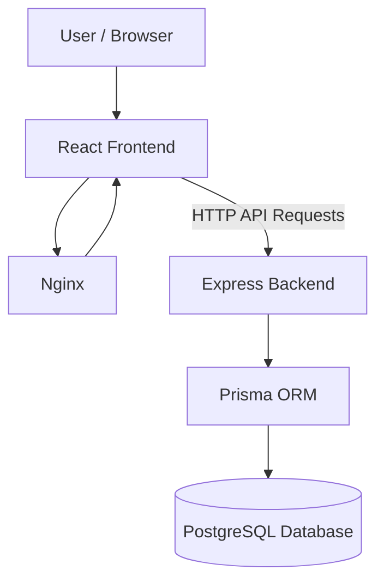
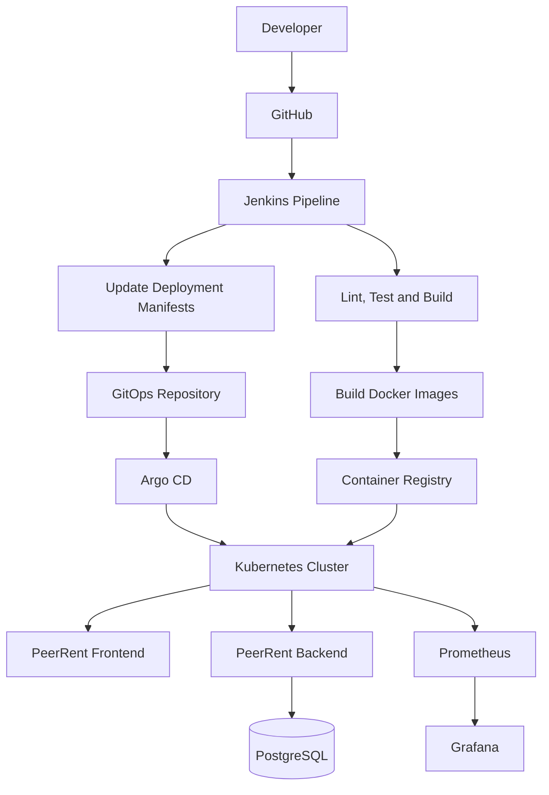

# PeerRent — Peer-to-Peer Rental Marketplace

<p align="center">
  <strong>Rent what you need. Earn from what you own.</strong>
</p>

<p align="center">
  A full-stack rental marketplace with a containerized deployment and a cloud-native DevOps roadmap.
</p>

<p align="center">
  
  
  
  
  
  
  
  
</p>

---

## 📌 Table of Contents

- [About the Project](#-about-the-project)
- [Features](#-features)
- [Technology Stack](#-technology-stack)
- [System Architecture](#-system-architecture)
- [Project Structure](#-project-structure)
- [Prerequisites](#-prerequisites)
- [Getting Started](#-getting-started)
- [Run with Docker](#-run-with-docker)
- [Environment Variables](#-environment-variables)
- [DevOps and CI/CD Architecture](#-devops-and-cicd-architecture)
- [Jenkins Pipeline](#-jenkins-pipeline)
- [Kubernetes Deployment](#-kubernetes-deployment)
- [Argo CD GitOps](#-argo-cd-gitops)
- [Monitoring with Prometheus and Grafana](#-monitoring-with-prometheus-and-grafana)
- [Useful Commands](#-useful-commands)
- [Troubleshooting](#-troubleshooting)
- [Roadmap](#-roadmap)
- [Contributing](#-contributing)
- [Author](#-author)
- [License](#-license)

## 🚀 About the Project

**PeerRent** is a peer-to-peer rental marketplace that connects people who want to rent items with people who own them.

Instead of purchasing products that are needed only occasionally, users can discover listings, manage their own items, book rentals, save favorites, and interact with a shared marketplace.

The application is built with React, Node.js, Express, PostgreSQL, and Prisma. Docker and Docker Compose provide the foundation for running the application in containers.

The project also serves as a hands-on DevOps portfolio project, with the goal of building an automated delivery workflow using Jenkins, Kubernetes, Argo CD, Prometheus, and Grafana.

### 🎯 Project Goals

- Build a usable, responsive rental marketplace.
- Develop and maintain a full-stack web application.
- Containerize application services with Docker.
- Automate builds and validation through CI.
- Deploy application containers to Kubernetes.
- Implement GitOps-based delivery with Argo CD.
- Monitor application and infrastructure health using Prometheus and Grafana.

## ✨ Features

### 🛍️ Marketplace

- Browse rental listings.
- View item details.
- Create new listings.
- Edit existing items.
- Manage personal listings.
- Display loading, empty, and error states.

### 👤 Authentication and Accounts

- User registration and login.
- Protected application routes.
- Authentication context and token handling.
- Password recovery and reset pages.
- User dashboard.

### 📅 Rentals and Bookings

- Booking-related workflows.
- View personal bookings.
- Manage listed items.
- Support for rental payment integration.

### ❤️ Wishlist and Notifications

- Save items to a wishlist.
- Manage saved items.
- View notifications.
- Review and rating functionality.

### 🎨 Frontend Experience

- React component-based architecture.
- Vite development and production builds.
- Responsive layout and navigation.
- Reusable interface components.
- Skeleton loaders and confirmation dialogs.
- Error boundaries and fallback UI.

### 🐳 Containerization

- Separate frontend and backend Dockerfiles.
- Docker Compose orchestration for local development.
- PostgreSQL container with persistent storage.
- Nginx-based frontend serving.
- Container networking and environment configuration.

> Features that depend on external integrations, such as payments, image hosting, or email, require the corresponding services and valid credentials.

## 🧰 Technology Stack

### Application Technologies

| Technology | Purpose |
|---|---|
| React | Frontend user interface |
| Vite | Frontend development server and build tool |
| JavaScript | Application logic |
| CSS | Styling and responsive layouts |
| Node.js | Backend runtime |
| Express.js | Backend API framework |
| PostgreSQL | Relational database |
| Prisma ORM | Database access and migrations |
| Nginx | Production frontend web server |
| JWT | Token-based authentication |
| Cloudinary | Image hosting integration |
| Razorpay | Payment integration |

### DevOps and Cloud-Native Technologies

| Technology | Purpose | Status |
|---|---|---|
| Git | Version control | In use |
| GitHub | Source code hosting | In use |
| Docker | Containerization | Configured |
| Docker Compose | Local multi-container orchestration | Configured |
| Jenkins | CI pipeline automation | Planned |
| Docker Registry | Versioned image storage | Planned |
| Kubernetes | Container orchestration | Planned |
| Argo CD | GitOps continuous delivery | Planned |
| Prometheus | Metrics collection | Planned |
| Grafana | Monitoring dashboards | Planned |

The status column should be updated as each technology is implemented and tested.

## 🏗️ System Architecture

The current containerized application consists of a frontend, backend API, and PostgreSQL database.



### Component Responsibilities

| Component | Responsibility |
|---|---|
| React + Vite | User interface and frontend build |
| Nginx | Serves the production frontend |
| Express.js | Handles API requests and business logic |
| Prisma | Connects backend logic to the database |
| PostgreSQL | Persistent application data |
| Docker Compose | Starts and connects the local services |

## 📁 Project Structure

```text
PeerRent-DevOps/
│
├── backend/
│   ├── prisma/
│   ├── src/
│   ├── .dockerignore
│   ├── Dockerfile
│   ├── package.json
│   └── server.js
│
├── frontend/
│   ├── public/
│   ├── src/
│   │   ├── api/
│   │   ├── components/
│   │   ├── context/
│   │   ├── layouts/
│   │   ├── pages/
│   │   └── services/
│   ├── .dockerignore
│   ├── Dockerfile
│   ├── nginx.conf
│   └── package.json
│
├── .gitignore
├── docker-compose.yml
└── README.md
```

As the DevOps implementation grows, the repository may also contain:

```text
├── Jenkinsfile
├── k8s/
├── argocd/
└── monitoring/
```

These directories and files should be added when their respective configurations are implemented.

## 📋 Prerequisites

For local development:

- Git
- Node.js and npm
- PostgreSQL, or Docker Desktop with Docker Compose

For the containerized application:

- Docker Desktop or Docker Engine
- Docker Compose v2
- A backend `.env` file with the required application configuration

Check your installation:

```bash
git --version
node --version
npm --version
docker --version
docker compose version
```

## 🚀 Getting Started

### 1. Clone the repository

Replace the example URL with your actual GitHub repository URL.

```bash
git clone https://github.com/YOUR_USERNAME/PeerRent-DevOps.git
cd PeerRent-DevOps
```

### 2. Configure the backend

```bash
cd backend
npm install
```

Create `backend/.env` using the environment variable reference below. Configure a valid PostgreSQL connection string and any credentials required by your enabled integrations.

### 3. Configure the frontend

```bash
cd ../frontend
npm install
```

Create `frontend/.env` with the API URL:

```env
VITE_API_URL=http://localhost:5000/api
```

### 4. Start the development application

Ensure PostgreSQL is running and the backend environment is configured.

Open a terminal for the backend:

```bash
cd backend
npm run dev
```

Open another terminal for the frontend:

```bash
cd frontend
npm run dev
```

The Vite development URL is typically `http://localhost:5173`, unless configured differently.

## 🐳 Run with Docker

Docker Compose is the recommended way to start the containerized application.

### 1. Start Docker

Open Docker Desktop and wait until the Docker engine is running.

### 2. Configure environment variables

Ensure `backend/.env` exists and contains the values needed by your backend.

Do not commit environment files containing real credentials.

### 3. Build the images

Run these commands from the project root:

```bash
docker compose build
```

To rebuild frontend and backend images without using the build cache:

```bash
docker compose build --no-cache frontend backend
```

### 4. Start the containers

```bash
docker compose up -d
```

### 5. Check container status

```bash
docker compose ps
```

### 6. Access the application

With the current local Compose port configuration:

| Service | Address |
|---|---|
| Frontend | http://localhost:8080 |
| Backend root endpoint | http://localhost:5000 |
| PostgreSQL | localhost:5432 |

The backend API is mounted under `/api`. The root backend endpoint can be used to verify that the Express server responds.

### 7. Inspect logs

```bash
docker compose logs -f
```

For an individual service:

```bash
docker compose logs -f frontend
docker compose logs -f backend
docker compose logs -f postgres
```

### 8. Stop the application

```bash
docker compose down
```

This normally preserves named database volumes. Avoid `docker compose down -v` unless you intentionally want to delete the associated persistent data.

## 🔐 Environment Variables

Environment variables vary according to enabled features and the backend configuration.

### Backend: `backend/.env`

| Variable | Description |
|---|---|
| `DATABASE_URL` | PostgreSQL connection string |
| `PORT` | Backend port, typically `5000` |
| `JWT_SECRET` | Secret for signing authentication tokens |
| `FRONTEND_URL` | Allowed frontend origin for CORS |
| `CLOUDINARY_CLOUD_NAME` | Cloudinary account name |
| `CLOUDINARY_API_KEY` | Cloudinary API key |
| `CLOUDINARY_API_SECRET` | Cloudinary API secret |
| `RAZORPAY_KEY_ID` | Payment integration key ID |
| `RAZORPAY_KEY_SECRET` | Payment integration secret |
| `EMAIL_USER` | Configured email account |
| `EMAIL_PASS` | Email credential or app password |

Configure only the integrations you need. Use strong secrets and keep them out of Git.

### Frontend: `frontend/.env`

```env
VITE_API_URL=http://localhost:5000/api
```

**Security note:** Variables prefixed with `VITE_` are available to client-side code and can be embedded in the built frontend. Never put private credentials in them.

For deployment, configure the API URL and CORS origin to match the actual frontend and backend addresses. If the frontend uses a different API URL at build time, rebuild the image with the correct value.

## 🔄 DevOps and CI/CD Architecture

The target DevOps architecture introduces automated builds, container publishing, Kubernetes deployment, GitOps reconciliation, and monitoring.



*This is the target architecture, not a claim that every component is already deployed.*

### End-to-End Workflow

1. Developers push code to GitHub.
2. Jenkins detects the change and starts a pipeline.
3. The pipeline installs dependencies and runs lint, build, and test stages.
4. Jenkins builds versioned frontend and backend container images.
5. Validated images are pushed to a container registry.
6. Deployment manifests are updated in Git.
7. Argo CD reconciles the desired configuration with Kubernetes.
8. Kubernetes runs and manages the application workloads.
9. Prometheus collects configured metrics.
10. Grafana visualizes application and infrastructure performance.

Jenkins handles CI and image creation. Argo CD handles GitOps-based synchronization and delivery.

## 🔧 Jenkins Pipeline

Jenkins will automate the build and validation workflow using a version-controlled `Jenkinsfile`.

### Planned pipeline stages

1. **Checkout** — Fetch application source code from GitHub.
2. **Install** — Install frontend and backend dependencies.
3. **Validate** — Run linting, build checks, and available tests.
4. **Containerize** — Build Docker images for the application services.
5. **Scan** — Perform dependency and image vulnerability checks.
6. **Publish** — Push versioned images to the configured registry.
7. **Update manifests** — Update the GitOps configuration with the new image tags.

A pipeline should fail when required validation stages fail. Secrets used by Jenkins should be stored in its credential-management system rather than committed to the repository.

## ☸️ Kubernetes Deployment

Kubernetes will orchestrate the PeerRent containers and manage their desired state.

### Planned resources

| Resource | Purpose |
|---|---|
| Namespace | Isolate application resources |
| Deployment | Manage frontend and backend replicas |
| Service | Provide stable networking between workloads |
| ConfigMap | Store non-sensitive application configuration |
| Secret | Supply sensitive configuration to workloads |
| Ingress | Provide external HTTP/HTTPS routing |
| PersistentVolumeClaim | Request persistent storage where required |
| Readiness probe | Determine when a workload is ready |
| Liveness probe | Detect unhealthy containers |
| Resource requests and limits | Define resource allocation boundaries |

### Suggested directory structure

```text
k8s/
├── namespace.yaml
├── frontend-deployment.yaml
├── frontend-service.yaml
├── backend-deployment.yaml
├── backend-service.yaml
├── configmap.yaml
├── ingress.yaml
└── postgres/
```

The database deployment strategy should be chosen deliberately. For production, a managed PostgreSQL service or a properly operated stateful database is generally preferable to treating a database container like a stateless application.

## 🔁 Argo CD GitOps

Argo CD will be used to implement GitOps-based continuous delivery.

### Planned capabilities

- Track Kubernetes manifests stored in Git.
- Detect changes to the desired application configuration.
- Synchronize Kubernetes resources with approved Git changes.
- Report application health and synchronization status.
- Support rollback by reverting a deployment change in Git.

### Proposed repository organization

```text
argocd/
├── application.yaml
└── applications/
```

Jenkins can publish application images and update image tags in Git. Argo CD then reconciles the Kubernetes environment with the desired state stored in the configured Git repository.

The GitOps repository should not contain unencrypted passwords, API keys, or other sensitive credentials.

## 📊 Monitoring with Prometheus and Grafana

Monitoring will help make the deployment observable and easier to troubleshoot.

### Prometheus

Prometheus is planned for metrics collection and monitoring.

Potential metrics sources include:

- Kubernetes and node metrics.
- Container CPU and memory utilization.
- Pod restarts and workload availability.
- Backend request latency and error rates, once application instrumentation is added.
- PostgreSQL metrics, when a suitable exporter is configured.

### Grafana

Grafana will visualize the collected metrics through dashboards.

Potential dashboards include:

- Kubernetes cluster health.
- Pod and container resource usage.
- Backend API performance.
- Service availability and error rates.
- Database performance and health.

Prometheus exporters and backend instrumentation must be configured before their metrics will be available. Alert rules and notification channels can be added as the monitoring setup matures.

## 🛠️ Useful Commands

### Docker

```bash
# Build all services
docker compose build

# Start the application
docker compose up -d

# View running services
docker compose ps

# Follow service logs
docker compose logs -f

# Restart services
docker compose restart

# Stop services
docker compose down
```

### Frontend

Run from `frontend/`:

```bash
npm install
npm run dev
npm run build
npm run lint
```

### Backend

Run from `backend/`:

```bash
npm install
npm run dev
npm start
npm run build
```

The backend build script generates the Prisma client. Database migrations should be applied using the migration workflow appropriate for the environment.

### Prisma migration status

For a running Compose setup:

```bash
docker compose exec backend npx prisma migrate status
```

If the project has valid migrations that have not yet been applied, use the appropriate deployment migration command after verifying the database connection and migration history.

## 🧯 Troubleshooting

### Frontend cannot reach the backend

- Check that the backend container is running.
- Verify the frontend API URL.
- Check the backend CORS configuration.
- Inspect backend logs.
- Confirm that the API URL is reachable from the browser.

### Database tables are missing

- Verify `DATABASE_URL`.
- Check Prisma migration status.
- Confirm that the correct PostgreSQL database is being used.
- Apply existing migrations using the project's migration workflow.
- Avoid resetting or deleting a database containing data you want to keep.

### A container keeps restarting

```bash
docker compose ps
docker compose logs --tail=100 backend
docker compose logs --tail=100 frontend
docker compose logs --tail=100 postgres
```

Check environment configuration, application logs, port conflicts, and database connectivity.

### Port 5432 is already in use

Another local PostgreSQL service may already be using port `5432`. Check which service owns the port before stopping it or changing your Docker port mapping.

### Docker changes do not appear

Rebuild the affected image and recreate the relevant service:

```bash
docker compose build frontend backend
docker compose up -d
```

For frontend configuration changes embedded at build time, rebuilding the frontend image is particularly important.

## 🗺️ Roadmap

### Application and Containers

- [x] Build the React frontend and Express backend.
- [x] Configure PostgreSQL with Docker Compose.
- [x] Add frontend and backend Dockerfiles.
- [x] Configure Nginx for the frontend production build.
- [ ] Expand automated testing and validation.

### Continuous Integration

- [ ] Add a Jenkinsfile.
- [ ] Automate frontend linting and builds.
- [ ] Add backend tests and validation.
- [ ] Build and scan versioned Docker images.
- [ ] Publish images to a container registry.

### Kubernetes and GitOps

- [ ] Create Kubernetes manifests.
- [ ] Configure services, probes, and resource limits.
- [ ] Configure ingress and HTTPS.
- [ ] Set up Argo CD.
- [ ] Automate deployment-manifest updates through GitOps.

### Monitoring and Security

- [ ] Deploy Prometheus and configure metrics sources.
- [ ] Configure Grafana dashboards.
- [ ] Add health alerts and notification channels.
- [ ] Introduce secure secret management.
- [ ] Document deployment and recovery procedures.

> Roadmap checkboxes should be marked complete only after the relevant component has been implemented and verified.

## 🤝 Contributing

Contributions, bug reports, and improvement suggestions are welcome.

1. Fork the repository.
2. Create a feature branch.
3. Make and test your changes.
4. Commit with a clear message.
5. Open a Pull Request describing your contribution.

Please avoid committing environment files, credentials, personal data, and generated build artifacts.

## 👩‍💻 Author

**Mugdha Dawkhar**

GitHub: [@MugdhaDawkhar16](https://github.com/MugdhaDawkhar16)

## 📄 License

A license has not been specified in this README. Add a `LICENSE` file and update this section when you choose an appropriate license for the project.

---

<p align="center">
  <strong>PeerRent — Making sharing easier, one rental at a time.</strong>
</p>
