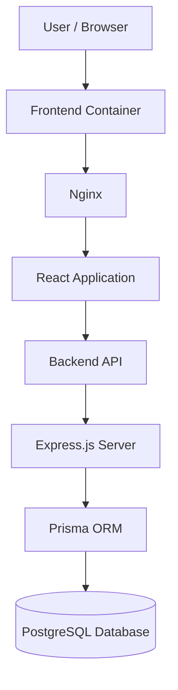

# PeerRent — Peer-to-Peer Rental Marketplace

**Rent what you need. Earn from what you own.**

PeerRent is a peer-to-peer rental marketplace designed to connect people who want to rent useful items with people who own them. Instead of purchasing items that are needed only occasionally, users can discover listings, book items, manage rentals, and make better use of existing resources.

The project combines a modern React frontend, a Node.js and Express backend, PostgreSQL database storage, and Docker-based containerization.

<p align="center">
  <strong>React · Vite · Node.js · Express · PostgreSQL · Prisma · Docker</strong>
</p>

---

## 📌 Table of Contents

- [Project Overview](#-project-overview)
- [Features](#-features)
- [Technology Stack](#-technology-stack)
- [Architecture](#-architecture)
- [Project Structure](#-project-structure)
- [Getting Started](#-getting-started)
- [Running with Docker](#-running-with-docker)
- [Environment Variables](#-environment-variables)
- [Useful Commands](#-useful-commands)
- [DevOps Roadmap](#-devops-roadmap)
- [Troubleshooting](#-troubleshooting)
- [Contributing](#-contributing)
- [Author](#-author)
- [License](#-license)

## 🚀 Project Overview

PeerRent aims to make renting and sharing everyday items convenient through a single web application.

Users can explore available items, manage their own listings, handle bookings, save favorites, and interact with the rental marketplace through an intuitive interface.

The project is also being developed as a practical DevOps learning project, with containerization and deployment automation as key areas of focus.

## ✨ Features

### 🛍️ Marketplace
- Browse available rental items.
- View item details and listing information.
- Create and manage item listings.
- Edit existing listings.
- Discover items through the marketplace interface.

### 👤 User Management
- User registration and login.
- Authentication and protected routes.
- User dashboard and account-related pages.
- Password recovery and reset workflows.

### 📅 Rental Management
- Booking-related workflows.
- View and manage personal bookings.
- Manage items listed by the user.
- Support for rental-related payment workflows.

### ❤️ Personalization and Notifications
- Save items to a wishlist.
- Manage wishlist items.
- View notifications.
- Review and rating functionality.

### 🎨 User Interface
- Responsive React-based interface.
- Reusable UI components.
- Loading skeletons and empty states.
- Error handling and confirmation dialogs.
- Consistent styling and navigation.

### ⚙️ Containerization
- Dockerfile for the frontend.
- Dockerfile for the backend.
- Docker Compose configuration for the application services.
- PostgreSQL container with persistent volume storage.
- Nginx to serve the production frontend build.
- Container networking for frontend, backend, and database communication.

> Feature availability depends on the current implementation and configuration of the application and its external services.

## 🧰 Technology Stack

| Category | Technologies |
|---|---|
| Frontend | React, Vite, JavaScript, CSS |
| Backend | Node.js, Express.js |
| Database | PostgreSQL |
| ORM | Prisma |
| Frontend web server | Nginx |
| Containerization | Docker, Docker Compose |
| Authentication | JWT-based authentication |
| External integrations | Cloudinary, Razorpay, email services |
| Version control | Git, GitHub |

## 🏗️ Architecture

The application uses a containerized, multi-service architecture.



### Service responsibilities

| Service | Responsibility |
|---|---|
| Frontend | Provides the user interface and communicates with the backend API. |
| Nginx | Serves the built frontend application. |
| Backend | Handles API requests and application logic. |
| Prisma | Provides database access through the configured Prisma schema. |
| PostgreSQL | Stores application data persistently. |

Docker Compose provides a convenient way to run the services together locally.

## 📁 Project Structure

```text
peer-rental-marketplace/
│
├── backend/
│   ├── prisma/
│   ├── src/
│   ├── Dockerfile
│   ├── .dockerignore
│   ├── package.json
│   └── server.js
│
├── frontend/
│   ├── public/
│   ├── src/
│   │   ├── api/
│   │   ├── components/
│   │   ├── context/
│   │   ├── layouts/
│   │   ├── pages/
│   │   └── services/
│   ├── Dockerfile
│   ├── nginx.conf
│   ├── .dockerignore
│   └── package.json
│
├── .gitignore
├── docker-compose.yml
└── README.md
```

*The tree above is representative. Your local project may contain additional files.*

## 🖥️ Getting Started

### Prerequisites

For local development, install:

- [Git](https://git-scm.com/)
- [Node.js](https://nodejs.org/)
- npm, included with Node.js
- [PostgreSQL](https://www.postgresql.org/) or Docker Desktop

For the containerized setup, Docker Desktop with Docker Compose is sufficient for running the defined services.

### 1. Clone the repository

```bash
git clone https://github.com/YOUR_USERNAME/PeerRent-DevOps.git
cd PeerRent-DevOps
```

Replace `YOUR_USERNAME/PeerRent-DevOps` with your actual GitHub repository path.

### 2. Configure the backend

```bash
cd backend
npm install
```

Create a local `.env` file in the `backend/` directory and configure the variables described in the Environment Variables section.

### 3. Configure the frontend

```bash
cd ../frontend
npm install
```

Configure the frontend API URL in `frontend/.env`:

```env
VITE_API_URL=http://localhost:5000/api
```

### 4. Start the development servers

Start PostgreSQL separately, or use your existing Docker Compose database service.

In one terminal:

```bash
cd backend
npm run dev
```

In another terminal:

```bash
cd frontend
npm run dev
```

The development frontend and backend ports may depend on your local configuration.

## 🐳 Running with Docker

Docker Compose is the recommended way to run the containerized application.

### 1. Start Docker Desktop

Ensure Docker Desktop is running and the Docker engine is ready.

Verify the installation:

```bash
docker --version
docker compose version
```

### 2. Configure environment variables

Make sure `backend/.env` exists and contains the required values for authentication and any external integrations you use.

Do not commit this file to GitHub.

### 3. Build the containers

From the project root:

```bash
docker compose build
```

To rebuild the frontend and backend without using the build cache:

```bash
docker compose build --no-cache frontend backend
```

### 4. Start the application

```bash
docker compose up -d
```

Check container status:

```bash
docker compose ps
```

### 5. Access the application

With the current local Docker Compose port configuration:

| Service | URL |
|---|---|
| Frontend | http://localhost:8080 |
| Backend root endpoint | http://localhost:5000 |
| PostgreSQL | localhost:5432 |

The backend root endpoint can be used to check whether the Express server responds. API endpoints are mounted under `/api`.

### 6. View logs

```bash
docker compose logs -f
```

To inspect a specific service:

```bash
docker compose logs -f frontend
docker compose logs -f backend
docker compose logs -f postgres
```

### 7. Stop the application

```bash
docker compose down
```

This stops and removes the Compose containers while preserving named volumes by default.

**Important:** Avoid `docker compose down -v` unless you intentionally want to remove the database volume and its stored data.

## 🔐 Environment Variables

Create local environment files as needed. The exact required variables depend on the backend implementation and enabled integrations.

### Backend — `backend/.env`

| Variable | Purpose |
|---|---|
| `DATABASE_URL` | PostgreSQL connection string |
| `PORT` | Backend server port |
| `JWT_SECRET` | Secret used for token signing |
| `FRONTEND_URL` | Frontend origin for CORS configuration |
| `CLOUDINARY_CLOUD_NAME` | Cloudinary account configuration |
| `CLOUDINARY_API_KEY` | Cloudinary API key |
| `CLOUDINARY_API_SECRET` | Cloudinary API secret |
| `RAZORPAY_KEY_ID` | Razorpay integration key ID |
| `RAZORPAY_KEY_SECRET` | Razorpay integration secret |
| `EMAIL_USER` | Email account used by configured mail functionality |
| `EMAIL_PASS` | Email credential or app password |

Only configure credentials for integrations you actually use. Keep all real credentials private and out of version control.

### Frontend — `frontend/.env`

```env
VITE_API_URL=http://localhost:5000/api
```

Vite exposes variables prefixed with `VITE_` to client-side code. Never put private API secrets or backend credentials in frontend environment variables.

> For a production deployment, configure the frontend API URL and backend CORS origin to match the actual deployment domains. Frontend Vite environment values are generally embedded at build time.

## 🛠️ Useful Commands

### Docker

```bash
# Build services
docker compose build

# Start services in the background
docker compose up -d

# View service status
docker compose ps

# Follow logs
docker compose logs -f

# Restart services
docker compose restart

# Stop services
docker compose down
```

### Frontend

Run these commands from `frontend/`:

```bash
npm install
npm run dev
npm run build
npm run lint
```

### Backend

Run these commands from `backend/`:

```bash
npm install
npm run dev
npm start
npm run build
```

The backend build script generates the Prisma client. Database migrations should be applied using the migration workflow configured for the project.

## ☸️ DevOps Roadmap

The project is intended to evolve beyond local containerization into a more complete DevOps workflow.

- [x] Containerize the frontend.
- [x] Containerize the backend.
- [x] Run the application with Docker Compose.
- [x] Configure PostgreSQL persistence.
- [ ] Add automated testing to the CI pipeline.
- [ ] Implement Jenkins-based continuous integration.
- [ ] Build and publish versioned Docker images.
- [ ] Deploy to Kubernetes.
- [ ] Manage Kubernetes manifests with Helm or Kustomize.
- [ ] Configure Argo CD for GitOps-based continuous delivery.
- [ ] Add application health checks, monitoring, and centralized logging.
- [ ] Introduce deployment security checks and secret management.

*Roadmap items are planned work, not claims that these tools are already deployed.*

## 🧯 Troubleshooting

### Frontend cannot reach the backend

- Check that the backend container is running.
- Verify `VITE_API_URL`.
- Confirm that the backend CORS configuration allows the frontend origin.
- Check the backend logs for errors.

### Database tables are missing

Check the backend logs and Prisma migration status. If the project has valid Prisma migrations, apply them using the appropriate migration command for the configured environment.

For a running Compose setup, migration status can be inspected with:

```bash
docker compose exec backend npx prisma migrate status
```

For a development database, use the migration workflow appropriate to your Prisma schema and existing migration history. Do not reset a database containing data you want to keep.

### A container keeps restarting

Inspect the service logs:

```bash
docker compose logs --tail=100 backend
docker compose logs --tail=100 frontend
docker compose logs --tail=100 postgres
```

Check environment configuration, build output, port conflicts, and database connectivity.

### Port 5432 is already in use

Another local PostgreSQL server may already be using port `5432`. Check which service owns the port before changing the Compose mapping or stopping any service.

## 🤝 Contributing

Contributions, bug reports, and suggestions are welcome.

1. Fork the repository.
2. Create a feature branch.
3. Make your changes.
4. Run the relevant build and lint checks.
5. Commit your changes with a clear message.
6. Open a Pull Request describing your changes.

Please do not commit `.env` files, private credentials, generated build artifacts, or personal data.

## 👩‍💻 Author

**Mugdha Dawkhar**

GitHub: [@MugdhaDawkhar16](https://github.com/MugdhaDawkhar16)

## 📄 License

No license has been specified here yet. Add a `LICENSE` file and update this section if you decide to distribute the project under a particular open-source license.

---

<p align="center">
  <strong>PeerRent — Making sharing easier, one rental at a time.</strong>
</p>
